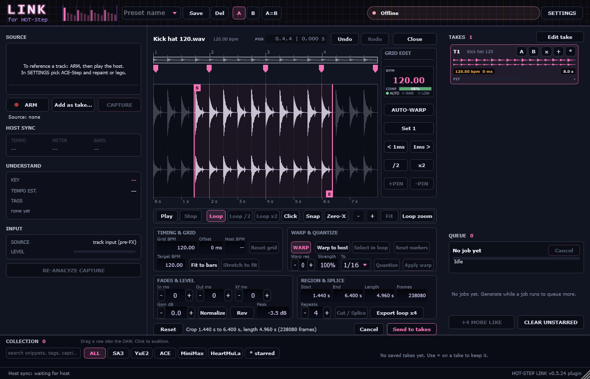
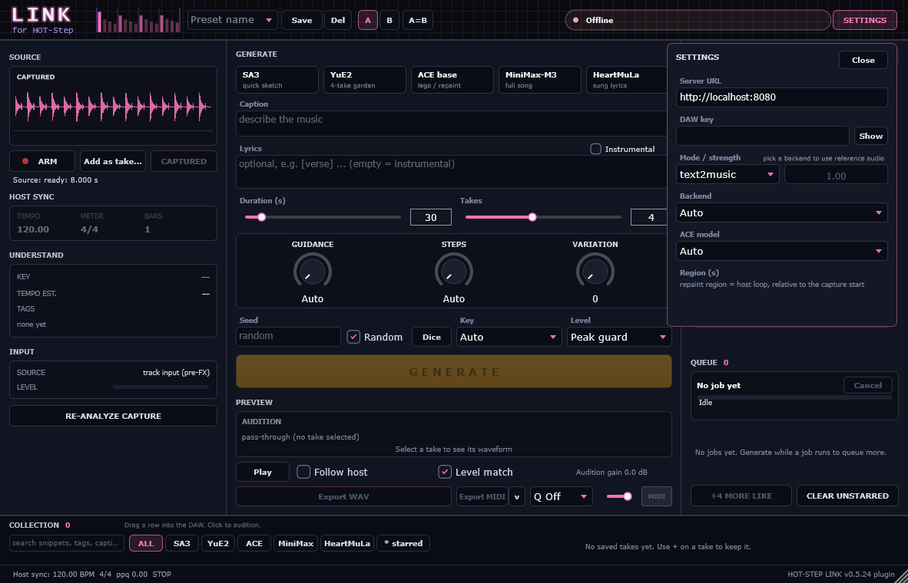

<p align="center">
<picture>
  <source media="(prefers-color-scheme: dark)" srcset="docs/assets/link_logo_dark.svg">
  <source media="(prefers-color-scheme: light)" srcset="docs/assets/link_logo_light.svg">
  
</picture>
</p>

# HOT-STEP LINK

A VST3 plugin and Standalone application that connects a DAW (or desktop session) to a running local [HOT-Step](https://github.com/scragnog/HOT-Step-CPP) server. You type a caption, pick a mode, and the plugin sends a generation request over HTTP. Audio generation happens entirely in HOT-Step; the plugin handles host sync, capture, take playback, and drag-out.

**Status: v0.5.24 beta, pre-release.** Rounds R1 through R6 pass the console test suite. Ableton Live was tested by hand on 2026-10-07. Reaper and Bitwig have not been tested by hand; see [Unverified sections](#unverified) below. An unsigned Windows zip (VST3, CLAP, Standalone) is available; see [Install](#install). This release (0.5.24) also has a Mac zip (universal, unvalidated beta: no Mac validation run is recorded); see [Install](#install). Mac users can also build from source with `tools/build_mac.sh`. The Windows build is unsigned; the Mac build is ad-hoc signed, not notarized. Known issues for this beta are listed in `KNOWN_ISSUES.md` in the download zip; see also [Known issues](#known-issues) below.

**What is new in 0.5.24:**
- Take editor redesign (v5b layout): hero waveform with a seconds ruler, GRID EDIT panel beside the waveform, four framed cards (TIMING & GRID, WARP & QUANTIZE, FADES & LEVEL, REGION & SPLICE), and a footer row with Send to takes.
- GRID EDIT panel: BPM LCD with CONF bar and AUTO / RAW / LOW indicators, AUTO-WARP, Set 1, nudge earlier / later, /2 and x2, plus +PIN and -PIN for locking drift sections.
- CONF bar shows a confidence percentage for measured grids.
- Cut / Splice in REGION & SPLICE removes the loop region and joins the ends with an equal-power crossfade.
- Reference mode: locked by backend. Only ACE-Step reads reference audio; selecting Auto shows "pick a backend to use reference audio" in SETTINGS.
- SETTINGS: strength box sends cover_strength (0.0 to 1.0, default 1.00) for reference audio. Active only when ACE-Step is the backend.
- The ACE model selection (Turbo or Base) is remembered across backend switches.
- POS readout in the take editor shows bar.beat.tick and seconds simultaneously.
- Takes clamp to the per-backend maximum (HeartMuLa = 1); per-backend ignored settings are greyed with a mismatch note.

---

## Screenshots (0.5.24)

Take editor with a loop selected, the GRID EDIT panel and the edit cards:



Generate view with the Settings panel open (server URL, DAW key, mode, backend):



## Beta install

HOT-STEP LINK 0.5.24 beta is a VST3/CLAP plugin and Standalone app that sends generation requests to a running local HOT-Step server and brings the takes back into your DAW. It makes no audio by itself: HOT-Step must be running and reachable (default `http://127.0.0.1:3001`).

1. Install the Microsoft Visual C++ 2015-2022 x64 runtime if you do not have it: https://aka.ms/vs/17/release/vc_redist.x64.exe
2. Copy the `HOT-STEP LINK.vst3` folder to `C:\Program Files\Common Files\VST3\`.
3. Copy `HOT-STEP LINK.clap` to `C:\Program Files\Common Files\CLAP\`.
4. Optional: run `HOT-STEP LINK.exe` (Standalone) from anywhere.
5. Rescan plugins in your host.

The build is unsigned, so Windows SmartScreen may warn on first run. Known issues for this beta are in `KNOWN_ISSUES.md` in the download zip; the user guide is `Manual/HOT-STEP_LINK_User_Manual_v0.5.24.md` in the zip (`docs/MANUAL.md` in the repo).

Reporting bugs: send your host name and version, the HOT-Step backend you used, the steps to reproduce, and the text of any error or status line. Screenshots help. For crashes, include the crash dump or host log if one was written.

## Build from source

If you prefer not to run unsigned binaries, build it yourself with Visual Studio 2022, CMake 3.22+ and JUCE 8.0.12. See `docs/DEVELOPING.md` and the Build section below.

---

## Requirements

- HOT-Step running and reachable at `http://127.0.0.1:3001` (or any URL you configure).
- HOT-Step must have the `/api/v1/daw` facade enabled (present since the facade was added to the server; check `/api/v1/daw/status` returns `{ "api": 1 }` to confirm).
- For `lego` and `repaint` modes, HOT-Step must have a non-turbo base model available (`non_turbo_available` in the status response). Turbo-only setups can only use `text2music`.
- A C++ build toolchain: Visual Studio 2022 (MSVC) on Windows, or Clang/GCC on Linux and macOS.
- [JUCE 8.0.12](https://github.com/juce-framework/JUCE/releases/tag/8.0.12).
- CMake 3.22 or later.

---

## Build

### Windows (Visual Studio 2022)

```bat
git clone https://github.com/MDMAchine/hs-link.git
cd hs-link
build.bat
```

`build.bat` runs `cmake -B build -G "Visual Studio 17 2022" -A x64` then builds the Release configuration. The VST3, CLAP and Standalone artefacts land in `build\HOTSTEP_LINK_artefacts\Release\`.

`git` must be on PATH: the configure step uses it to fetch and patch dependencies. The first configure downloads JUCE and can take about 4 minutes with little output; let it run. As a guide, on one test machine a clean configure took about 3.9 minutes (JUCE 8.0.12 fetched) and the VST3 build about 1.8 minutes.

`JUCE_DIR` defaults to env `JUCE_DIR`, else `../JUCE` next to this repo; if JUCE is elsewhere, pass `-DJUCE_DIR=...`. If no JUCE checkout is found at `JUCE_DIR`, CMake falls back to FetchContent and downloads JUCE 8.0.12 from GitHub (needs network on the first configure):

```bat
cmake -B build -G "Visual Studio 17 2022" -A x64 -DJUCE_DIR=C:/path/to/JUCE
cmake --build build --config Release
```

### Linux / macOS

```sh
cmake -B build -DJUCE_DIR=/path/to/JUCE
cmake --build build --config Release
```

### Running the tests

```bat
build.bat test
```

Or after a manual build:

```
build\HSLINK_Tests_artefacts\Release\HSLINK_Tests.exe
```

The test binary covers host sync, capture ring, DawWorker offline detection, audition level-match and resampling, and stable take naming. See [docs/DEVELOPING.md](docs/DEVELOPING.md) for the teeth flags.

---

## Install

Windows x64 and macOS (universal Apple Silicon and Intel, macOS 11 or newer). Install by hand from the zip for your platform.

**Mac:** 0.5.24 has a Mac zip, `MDMAchine_HOT-STEP_LINK_<version>_beta_mac.zip` (AU, VST3, CLAP, Standalone; ad-hoc signed but not notarized, unvalidated beta). See `docs/mac/QUICKSTART_MAC.md` for where the bundles go and how to clear the quarantine flag. You can also build it from source with `tools/build_mac.sh` (output staged in `dist/`).

Download: the [Releases page](https://github.com/MDMAchine/hs-link/releases) of the public repo (`MDMAchine_HOT-STEP_LINK_<version>_beta_win.zip`; sha256 in the release notes)

Before you start, you need:

- HOT-Step v1.4.2 or newer, running on this machine or on your LAN. v1.4.2 is the first release with the `/api/v1/daw` API this plugin talks to. The plugin does not generate audio itself; it sends requests to HOT-Step.
- At least one HOT-Step backend set up: ACE-Step, SA3 (Stable Audio 3) or YuE2. The plugin offers whichever backends the server reports.
- HOT-Step with the DAW facade enabled: `http://127.0.0.1:3001/api/v1/daw/status` should return `{ "api": 1 }`.

### Manual install from the zip

The Windows files are **not code-signed**. Windows SmartScreen may show a blue "Windows protected your PC" box when you run the Standalone. To continue, click **More info**, then **Run anyway**.

The zip (`MDMAchine_HOT-STEP_LINK_<version>_beta_win.zip`; sha256 in the release notes) holds the three built files under `Win\`, plus `README.md`, `INSTALL.txt`, `KNOWN_ISSUES.md`, `CHANGELOG.md`, `LICENSE`, `BUILD_COMMIT.txt`, `SHA256SUMS.txt` and the user manual in `Manual\`:

- `Win\VST3\HOT-STEP LINK.vst3` (a folder; copy the whole folder, not just what is inside it)
- `Win\CLAP\HOT-STEP LINK.clap`
- `Win\Standalone\HOT-STEP LINK.exe`

Copy them like this (the two Common Files folders need administrator rights):

| File | Copy to |
|---|---|
| `HOT-STEP LINK.vst3` | `C:\Program Files\Common Files\VST3\` |
| `HOT-STEP LINK.clap` | `C:\Program Files\Common Files\CLAP\` (create the folder if it is missing) |
| `HOT-STEP LINK.exe` | anywhere you like; it is a single executable |

Windows may block files that came from a downloaded zip. If the host does not see the plugin, right-click the zip before extracting, open Properties, tick **Unblock**, then extract again.

### Rescan in your host

Close and reopen the host if it was open during the install, then rescan:

- Ableton Live: Settings, Plug-Ins, turn on "Use VST3 Plug-in System Folders", then Rescan.
- Reaper: Options, Preferences, Plug-ins, VST (or CLAP), then "Re-scan".
- Bitwig: Settings, Locations, Plug-ins; the system VST3 and CLAP folders are scanned by default, then rescan.
- Other hosts: add `C:\Program Files\Common Files\VST3` (or `...\CLAP`) to the scan paths if it is not there already, and rescan.

### Connect to HOT-Step

1. Start HOT-Step and wait until its web UI loads.
2. Load HOT-STEP LINK on a track, or run the Standalone.
3. The server URL defaults to `http://127.0.0.1:3001`. When the plugin can reach the server, the status bar turns green within a few seconds.
4. If HOT-Step runs on another machine, enter that machine's address (for example `http://192.168.1.20:3001`) and set a shared key; see [Network and security](#network-and-security).

### From source (developers)

The build does not copy the plugin anywhere (`COPY_PLUGIN_AFTER_BUILD` is `FALSE`). Artefacts land in `build\HOTSTEP_LINK_artefacts\Release\` under `VST3\`, `CLAP\` and `Standalone\`. Copy them by hand to a plugin folder you own, or to the system folders listed above.

On Linux and macOS, build from source and copy the `HOT-STEP LINK.vst3` bundle to `~/.vst3/` (Linux) or `~/Library/Audio/Plug-Ins/VST3/` (macOS), then rescan. These platforms have not been tested by hand.

---

## Quick start

1. Launch HOT-Step and confirm it is ready (the web UI loads).
2. Load the HOT-STEP LINK plugin on any track (or launch the Standalone).
3. The server URL defaults to `http://127.0.0.1:3001`. If HOT-Step is running, the status bar turns green within a few seconds.
4. Type a caption describing what you want.
5. Select a mode: `text2music`, `repaint`, or `lego`.
6. Set the backend and duration, then click Generate.
7. Takes appear in the grid as they complete. Click a take to audition it, then drag it to your timeline or click Export WAV.

### Quick start: using a reference track

Reference audio is read by the ACE-Step backend only. The other backends ignore it, so `repaint` and `lego` are locked for them and SETTINGS shows "reference audio needs ACE-Step" (or "pick a backend to use reference audio" on Auto).

1. Put HOT-STEP LINK on the track you want to reference and set a host loop over the part.
2. Press ARM, then play the host. The capture stops at the loop end or when the transport stops (STOP + KEEP ends it early). In the Standalone, click Drop WAV... instead.
3. The SOURCE waveform shows the clip and the header reads CAPTURED.
4. Open SETTINGS and set Backend to ACE-Step.
5. In the Mode / strength row pick `repaint` (redo the looped part of the clip) or `lego` (add a part over the clip). `repaint` needs a non-turbo model on the server, `lego` the base model.
6. Type a strength from 0.0 to 1.0 in the box beside the mode (default 1.00).
7. Close SETTINGS, type a caption, and click Generate.
8. Takes appear in the grid as they complete.

RE-ANALYZE CAPTURE is not a step in this: it only fills KEY, TEMPO EST. and the tags, and Generate does not use them. The first time the plugin opens, the empty SOURCE waveform shows a short version of these steps; click it to hide it for good.

---

## Network and security

HOT-Step binds on `0.0.0.0` with CORS wide open. The DAW facade accepts any origin by default. On a typical setup the plugin and server are on the same machine, so only loopback traffic is involved.

If you run HOT-Step on a different machine on your LAN, set a shared secret in HOT-Step's `config.yaml` (`HOTSTEP_DAW_KEY`) and enter the same value in the plugin's Key field. The plugin sends the key as `X-DAW-Key` on every request. Requests arriving from a non-loopback address without the correct key are rejected.

The key is stored per user in your application data folder (`HOT-Step/LINK.settings`), not in the project or preset file. This means the key does not travel with the session when you share or back up project files.

---

## License

AGPLv3. See [LICENSE](LICENSE).

The plugin communicates with HOT-Step over HTTP only. No HOT-Step source or binary is linked into the plugin. HOT-Step itself is GPL v3; the two licenses coexist because the only coupling is a network API call.

---

## Known issues

- ACE renders can come out slightly shorter than the requested duration (a 10 s request gave 9.44 s). This is engine-side, not the plugin.

---

## Unverified

The following items have not been verified in a real DAW:

- **Reaper and Bitwig have not been tested by hand.** Ableton Live was tested by hand on 2026-10-07. Basic host operations in Reaper and Bitwig (scan and load, state save and restore, host transport sync, drag to the timeline) are untested.
- Drag to timeline in hosts other than the mock (R6 uses `performExternalDragDropOfFiles`; not tested in Reaper, Live, or Bitwig).
- Sandboxed hosts (Logic Pro entitlement requirements, Bitwig sandbox). Network calls from inside a sandbox may be blocked.
- The level-match audition on macOS (WinINet timeout behavior is Windows-specific; the macOS NSURLSession path differs but has not been tested).
- YuE2 in batch mode: in the bench run the batch-4 path produced an OOM when SA3 was resident at the same time. Not reproduced under normal plugin startup conditions but possible with a warm keep-loaded server.
- **Backend switch, live server.** The backend switch (Generate with Backend set to a specific value) has not been checked against a live HOT-Step server. The switch timeout (10 s against a silent server) and the cancel of a switch in flight are not covered by tests.
